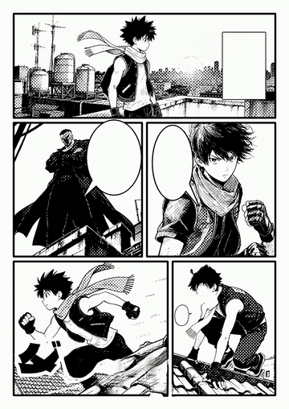
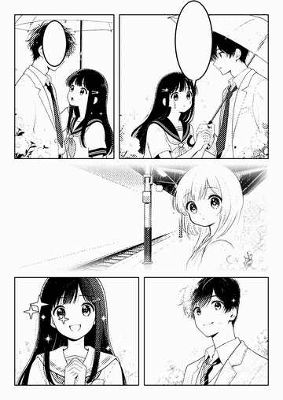
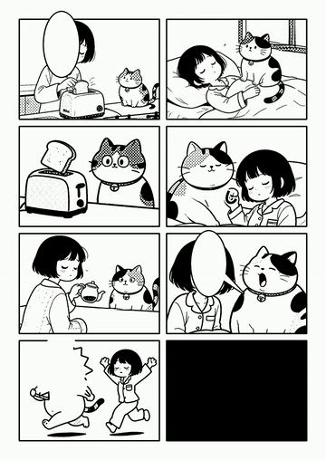
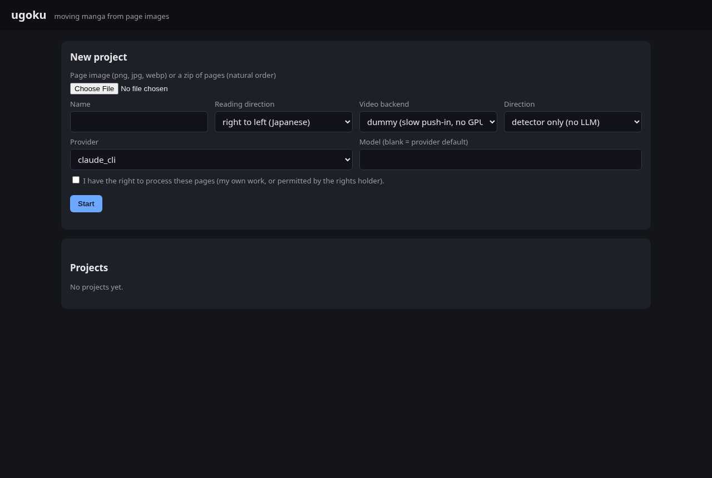
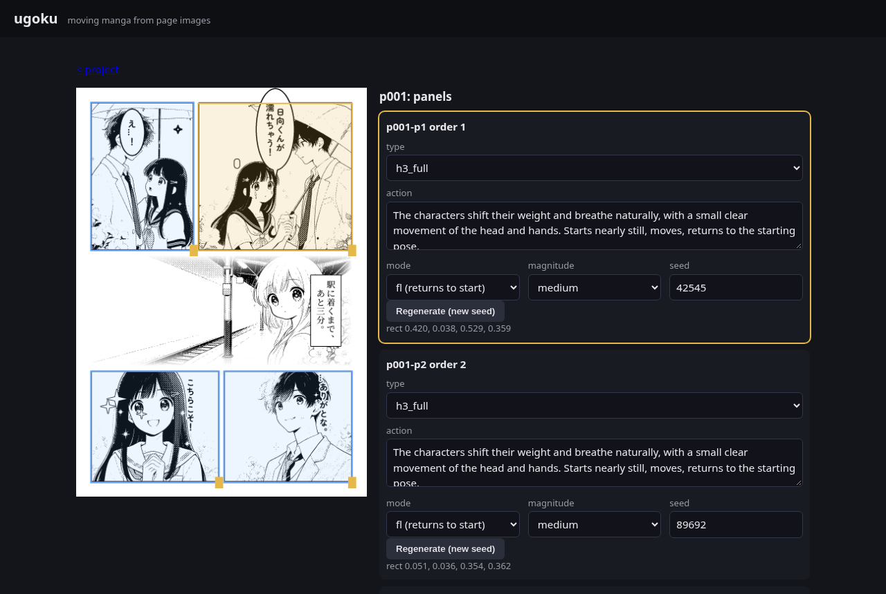

# ugoku（動くマンガ）

[English](README.md)

マンガのページ画像を入れると、再生できる「動くマンガ」が全自動で出来上がります。コマごとに短い生成動画が付き、フキダシと描き文字は読み順に現れ、
ブラウザで再生できます。任意で手直しできる Web UI も付属しています。

バージョン 0.1.0（最初の公開リリース、アルファ版）。変更履歴は `CHANGELOG.md`、仕組みは `docs/DESIGN.md`、品質の計測結果は `eval/rounds/` を参照してください。

| shonen-rooftop p01 | shojo-afterschool p03 | koma-morning p01 |
|---|---|---|
|  |  |  |

`samples/` の CC0 サンプル作品から、手作業の修正なしで作ったものです（演出はビジョン LLM、動画は ComfyUI 上の MiniMax H3）。
一番良いページではなく、典型的なページを選んでいます。静止画は `docs/media/*-p0?.png`、メディアのライセンスは `docs/media/README.md` にあります。

## インストール

Python 3.11 以上と、PATH 上の `ffmpeg`（libx264 と libvpx-vp9 付き）が必要です。

```
git clone <このリポジトリ> ugoku && cd ugoku
python -m venv .venv && . .venv/bin/activate
pip install -e ".[server]"           # Web UI には server extra が必要。CLI だけなら `pip install -e .` で足ります
ugoku models fetch ctd bubble        # テキスト検出とフキダシ検出のモデルを ~/.cache/ugoku/models に取得（ライセンスは NOTICE.md）
ugoku models list
```

インペイント用モデルには公開ダウンロードがありません。`lama-manga-dynamic.onnx` が無い場合は OpenCV の簡易インペイントを使います（品質は下がりますが試すには十分です）。
設定は `~/.config/ugoku/config.toml`（または `$UGOKU_CONFIG`）に書きます。どのキーも環境変数 `UGOKU_<KEY>`（例: `UGOKU_MODEL_DIR`）で上書きできます。
CPU だけで動く Docker イメージは `docker/cpu.Dockerfile` です。

## クイックスタート（GPU も API キーも不要）

```
ugoku run samples/shonen-rooftop/pages/*.png --direction samples/shonen-rooftop/direction.json --out out/   # dummy 動画バックエンド
python -m http.server -d out 8000    # http://localhost:8000 を開く。このサーバーは Range 非対応なので動画のシークは制限されます
```

`dummy` バックエンドでは、動くコマに生成動画の代わりにゆっくりしたズームが付きます。レイアウト、タイミング、プレイヤーの確認にはこれで足ります。
サンプル3作品はノート PC の CPU で数分で処理できます。

付属の演出ファイルの代わりにビジョン LLM に演出を書かせる場合:

```
export ANTHROPIC_API_KEY=...         # OPENAI_API_KEY / GEMINI_API_KEY でも可。ログイン済みのローカル `claude` CLI なら --provider claude_cli
ugoku direct my-pages/*.png --provider anthropic --out my.direction.json
ugoku run my-pages/*.png --direction my.direction.json --out out/
```

## Web UI

```
ugoku serve --data ugoku-data            # http://localhost:8771
ugoku serve --host 0.0.0.0 --public      # ネットワークに公開。ログイン機能が無いので信頼できるネットワーク内だけで使ってください
```

| アップロード | 編集 |
|---|---|
|  |  |

1. 画像1枚かページの zip（ファイル名順）をアップロードし、読み方向、動画バックエンド、演出の作り方（検出器のみ／ビジョン LLM／演出ファイルのアップロード）を選び、
   処理する権利があることを確認します。
2. ページとステージごとの進捗がリアルタイムで表示されます。
3. 終わったら必要に応じて、コマ枠をドラッグで直す、コマごとの動き（action）・mode・magnitude を編集する、シードを変えて動画を作り直す、ができます。
4. ギャラリー zip、ページごとの単一 HTML、ページ mp4、コマごとの動画を書き出せます。

## パイプライン

```
ページ画像 -> コマ検出（古典的手法 + LLM 補正） -> テキスト要素（セグメンテーション + 矩形検出） -> 読み順（コード、曖昧な所だけ LLM）
          -> 演出（LLM ワークフロー + バリデータ） -> 分離 / インペイント（文字なしベースページ、要素ごとのレイヤー） -> ステージ（動画用のコマ入力）
          -> 動画バックエンド（comfy_h3 | minimax_api | dummy） -> 合成（ギャラリー: ベース、レイヤー、動画、タイミング） -> プレイヤー / 書き出し
```

「モデルが判断し、コードが測る」が原則です。LLM は番号付きの検出候補から選び、コマごとの動きを書くだけで、座標・順序・タイミング・検証はコードが行います。
詳しくは `docs/DESIGN.md`（英語）を参照してください。

## モデルとハードウェア

| 処理 | 必要なもの |
|---|---|
| コマ、テキスト要素、読み順、分離、合成、プレイヤー | CPU と検出モデル（`ugoku models fetch`） |
| ビジョン LLM による演出（`ugoku direct`） | プロバイダ: `anthropic`、`openai_compat`、`gemini`（API キーは環境変数 `ANTHROPIC_API_KEY`、`OPENAI_API_KEY`、`GEMINI_API_KEY`）、または `claude_cli`（サブスクリプションでログイン済みのローカル `claude` CLI）。既定モデルは Claude Opus、安く済ませるなら Sonnet |
| 動画生成 `comfy_h3` | VRAM 約 24 GB の NVIDIA GPU（開発は RTX 3090、動くコマ1つあたり約10〜15分）、MiniMax H3 のノードと重みを入れた ComfyUI、ランナー（`local`、または別マシンやジョブキューの GPU 用の `external_command`。`examples/runner.external.toml` と `docker/comfy-gpu.Dockerfile` を参照） |
| 動画生成 `minimax_api` | 自分の MiniMax API キー（`MINIMAX_API_KEY`）。サービス側でプロンプトが加工されるため、ローカル実行とは結果が異なります。ページ画像はサービスに送信されます |
| 動画生成 `dummy` | 不要（テストとレイアウト確認用のゆっくりしたズーム） |
| `ffmpeg` | libx264 と libvpx-vp9 付きのものを PATH に |

モデルの重みは同梱していません。MiniMax H3 には独自のライセンス条件（地域や売上に関する条項など）があり、それはこのリポジトリではなく利用者に適用されます。
動画を生成・公開する前に確認してください。テキストセグメンテーションのモデルは上流が GPL-3.0 で、利用者が任意でダウンロードするものです（`NOTICE.md`）。

## 制限事項

- 動画の品質は、比較対象にした以前の非公開プロトタイプに届いていません。サンプルの動くコマ18個で、1〜5点のクリップスコア平均は 3.00（比較対象 3.30）、
  4点以上の割合は 22%（比較対象 37.5%）です。動きがほとんど見えないクリップや、向きが逆のクリップがあります。`eval/rounds/R05b.md` を参照してください。
- 枠線の無いコマやぼかしで終わるコマは、古典的なコマ検出ではよく見落とします。4コマの読み順も LLM 無しでは正しくないことがあります。
- コマをまたぐフキダシは、しっぽではなく文字の重なりと LLM のヒントでコマに割り当てています。
- 右から左に読む日本のマンガ向けに調整しています。左から右も動きますが、あまり試していません。
- `minimax_api` バックエンドは実装済みですが、実際のサービスに対しては未実行です。
- Web UI にはログインもマルチユーザー対応もありません。localhost か信頼できるネットワーク内で使ってください。
- マンガ向けインペイントモデルは手動の ONNX 書き出しが必要です（公開ダウンロード無し）。OpenCV の代替では文字を消したベースページの品質が下がります。

## 入力の権利

自分が権利を持つページ、または処理の許可を得たページだけを処理してください。ホスト型の LLM や動画 API を使うと、ページ画像はそのサービスにアップロードされます。

## 開発

```
pip install -e ".[dev]"
ruff check . && pytest -q                         # 検出モデルがあればゴールデンテストも実行されます
python -m playwright install chromium && pytest -q -m e2e tests/e2e
bash scripts/deny_grep.sh && python scripts/check_repo.py
```

`CONTRIBUTING.md` を参照してください。非公開の参照データによる評価は `eval/README.md` に説明があります。そのデータ由来のものはこのリポジトリには一切含まれていません。
サンプル作品（オリジナルのフィクション、CC0-1.0）は `samples/` にあり、`tools/sample_gen/` で再生成できます。

## ライセンス

コードは Apache-2.0（`LICENSE`）。サンプルは CC0-1.0（`samples/LICENSE`）。デモメディアは `docs/media/README.md`。サードパーティのモデルとフォントは `NOTICE.md`。
